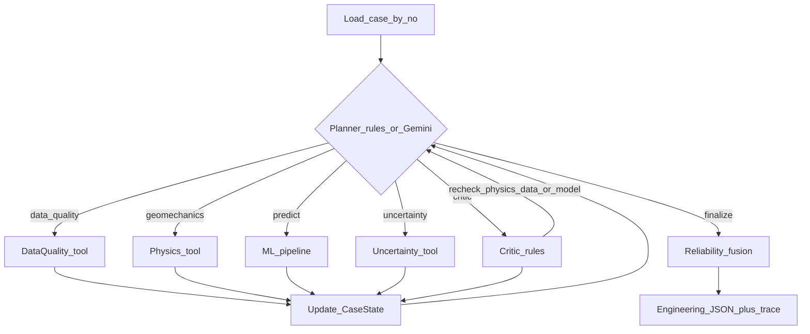

## What this project is

A **physics-guided multi-agent rockburst grade assessor** (grades 0–3). It does not only predict a class — it also scores how trustworthy that prediction is, can send a case back for re-checks, and can **abstain**.

Gemini (`gemini-3.8-flash`) is used only as the **planner** (choose next agent). Every number comes from deterministic Python tools.

---

## What’s been built (by layer)

### 1. Project scaffold
- Package: `src/rockburst/`
- Config: [`configs/default.yaml`](configs/default.yaml) (seeds, paths, thresholds, Gemini model)
- CLI: `extract | show | train | assess | evaluate`
- Env: `.env` / `.env.example` with `GOOGLE_API_KEY`
- Tests: physics, extract, routing (`pytest`)

### 2. Data pipeline
- PDF Table S1 → [`data/raw/rockburst.csv`](data/raw/rockburst.csv) (344 rows)
- Processed + `dup_group_id`: [`data/processed/rockburst_processed.csv`](data/processed/rockburst_processed.csv)
- Audits for missing `D` (~131), bad B1, OOD SCF, duplicates

**Features:** `σθ, σc, σt, SCF, B1, B2, Wet, D` → **target:** `rockburst_grade`

### 3. ML baselines (M1)
- Leakage-safe pipelines: impute + scale **inside** folds only
- Models: logistic, ordinal (`mord`), SVM, RF, ExtraTrees, XGBoost, LightGBM, CatBoost
- Imputers: median / KNN / iterative
- Split: `StratifiedGroupKFold` by duplicate groups
- Artefacts: `artifacts/models/best_baseline.joblib`, `ensemble.joblib`, `fusion.joblib`
- Metrics: accuracy, balanced acc, macro-F1, QWK, ordinal MAE, Brier, ECE, etc.

### 4. Deterministic agent tools
| Agent | Module | Returns |
|-------|--------|---------|
| Data Quality | `quality/checks.py` | `R_data`, OOD, missing, near-dups |
| Geomechanics | `physics/relations.py` | `R_physics` (exact SCF/B1/B2 + empirical Wet/D) |
| Predictive | `agents/tools.py` → trained pipeline | grade, probs, `R_model` |
| Uncertainty | `uncertainty/estimates.py` | conformal set, disagreement, perturbation stability |
| Critic | `agents/tools.py` | contradictions + `request_recheck` |
| Fusion | `fusion/stacker.py` | `R_final` + decision |

Schemas: Pydantic models in `agents/schemas.py`.

### 5. Coordinator (graph)
- [`src/rockburst/graph/runner.py`](src/rockburst/graph/runner.py)
- State machine: `CaseState` → next action → tool → update state
- **Rules planner** (default / offline)
- **Gemini planner** with `--llm` (falls back to rules if API fails)
- Traces written to `artifacts/traces/`

### 6. Experiments & deliverables
- Ablations M1–M7 + robustness + missing-data: `artifacts/baselines/ablation_results.json`
- Example JSONs (incl. abstain + failure): `artifacts/examples/`
- Reports: `reports/methodology.md`, `reports/technical_report.md`
- Notebook: `notebooks/end_to_end_demo.ipynb`

---

## End-to-end flows

### A. Offline / offline-setup flow (build once)


1. `extract` — PDF → CSV + audit  
2. `train` — fit baselines, ensemble, fusion stacker  
3. `assess` / `evaluate` — inference / ablations  

### B. Per-case assessment flow (the agentic loop)



**Typical happy path**
`data_quality → geomechanics → predict → uncertainty → (critic if needed) → finalize`

**Conditional branches**
- OOD / low physics / large prediction set / strong disagreement → **Critic**
- Critic can clear one of physics/data/model and request **one re-check**
- Hard stop at `max_loops=8` → forced abstain

**Finalize**
Combines:

`R_data, R_physics, R_model, R_uncertainty, R_stability` → learned `R_final` → decision:

- `accept`
- `accept_with_caution`
- `engineering_verification`
- `abstain` (also if large unstable set / high disagreement)

Output fields match the client brief: grade, probability, prediction set, physics consistency, input reliability, OOD, stability, disagreement, final confidence, plain-language decision, plus `route_trace`.

---

## How you run it

```bash
source .venv/bin/activate
python scripts/rockburst_cli.py extract
python scripts/rockburst_cli.py train --quick
python scripts/rockburst_cli.py assess --no 1          # rules planner
python scripts/rockburst_cli.py assess --no 146 --llm  # Gemini 3.8 Flash planner
python scripts/rockburst_cli.py evaluate --quick
```

---

## Design rule of thumb

| Layer | Who does what |
|-------|----------------|
| Gemini | Chooses next action only |
| Python tools | All physics, ML, scores, fusion |
| Fusion / abstain gates | Final engineering decision |

So: **LLM routes; code computes; fusion decides trust.**