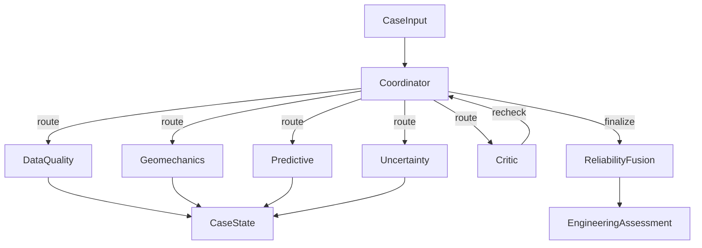

# Methodology — Agentic Rockburst Assessment

## Goal
Predict rockburst intensity grade \(0\)–\(3\) while quantifying trust via data reliability, physics consistency, model uncertainty, stability, and agent disagreement. The controller may abstain.

## Architecture

### State transitions
Typical happy path: `data_quality → (geomechanics | skip) → predict → uncertainty → finalize`.

**Physics skip (pre-registered):** a cheap deterministic pre-check (`physics/precheck.py`) skips full geomechanics only when SCF/B1/B2 agree within tolerance and Wet and D are in range; otherwise geomechanics runs.

**Extra validation:** when D is missing, any key feature is missing/imputed, or `data_reliability < 0.55`, run alt-imputer + targeted perturbation before Critic.

**Critic:** OOD, low physics, large conformal set, strong disagreement, or unresolved validation objections. Rechecks call **different** tools than the first pass (`recheck_physics` / `recheck_data` / `recheck_model`). Unresolved objections after recheck **downgrade** the decision one level (grade unchanged).

Hard stop at `max_loops=8` → forced abstain. LLM planner actions that lack preconditions are tagged `rejected:` and fall back to rules.

Planner: Gemini Flash (`configs/default.yaml` `gemini.planner_model`) when `--llm` and `GOOGLE_API_KEY` are set; otherwise identical **rule-based** predicates (default / offline). Trace tags: `llm:` / `rules:` / `fallback:` / `rejected:`.

## Agents and tools
| Agent | Deterministic tools | Key outputs |
|-------|---------------------|-------------|
| Data Quality | IQR, IsolationForest, near-duplicate search (raw-feature relative tolerance; train-fold reference excluding self/`dup_group_id`), missingness | `R_data`, OOD flag |
| Geomechanics | Exact `SCF`, `B1`, `B2`; empirical Wet/D ranges | `R_physics` |
| Predictive | Leakage-safe sklearn/boosting/SVM pipelines (nested Optuna) | grade, probs, `R_model` |
| Uncertainty | Entropy, ensemble disagreement, **split conformal** (finite-sample quantile), perturbations | `R_uncertainty`, `R_stability`, prediction set |
| Critic | Contradiction rules | `request_recheck` |
| Fusion | Constrained non-neg logistic + isotonic on live OOF `R_*` | `R_final`, decision (unfitted → abstain) |

## Near-duplicate grouping
`dup_group_id` is assigned by relative-tolerance matching on raw measured inputs
\(\sigma_\theta,\sigma_c,\sigma_t,W_{et},D\) (when present), default `near_dup_rel_tol=0.01`, via connected components.
Conflicting labels inside a group are **kept** (noise ceiling documented); `StratifiedGroupKFold` keeps each group in one fold.
Quality near-dup flags use the same tolerance; fold references drop the whole group.

## Exact physics
\[
\mathrm{SCF}=\sigma_\theta/\sigma_c,\quad
B_1=\sigma_c/\sigma_t,\quad
B_2=(\sigma_c-\sigma_t)/(\sigma_c+\sigma_t)
\]
Wet and depth \(D\) are empirical tendencies only.

## Reliability fusion
\[
R_{\mathrm{final}}=\sigma(w^\top [R_{\mathrm{data}},R_{\mathrm{physics}},R_{\mathrm{model}},R_{\mathrm{uncertainty}},R_{\mathrm{stability}}]+b)
\]
Weights \(w,b\) are learned by logistic regression on **out-of-fold** correctness using the **same** `compute_reliability_features` path as serving. Coefficients are constrained to be non-negative. Decision thresholds are selected on a held-out slice of OOF scores — never on the outer test fold.

## Conformal prediction
Grouped **split conformal** with nonconformity \(1-p_y\) and finite-sample quantile
\(\lceil(n+1)(1-\alpha)\rceil/n\). Mondrian, marginal, and grouped CV+ are compared on outer OOF;
the method closest to nominal \(1-\alpha\) without test-fold tuning is retained (currently **marginal split**).
Calibration holdouts are group-aware and disjoint from model fit and fusion training.

## Nested tuning and selection (M1)
Outer `StratifiedGroupKFold` evaluates; inner Optuna selects hyperparameters (`tuning.n_trials` equal per family, including SVM via `CalibratedClassifierCV`).
**Selection-biased** score: choose model×imputer by pooled outer OOF QWK (optimistic).
**Nested-unbiased** score: per outer fold choose model×imputer by inner QWK only, then score outer test.
Both are reported; production artefact uses the nested fold-winner mode. Full candidate table is written to `m1_results.json`.

## Ablation definitions (identical folds)
| ID | System |
|----|--------|
| M1 | Baseline ML predict only |
| M2 | M1 + permutation importance (interpretability sidecar; metrics = M1) |
| M3 | M1 + physics reliability adjustment |
| M4 | M1 + uncertainty / conformal abstention tracking |
| M5 | Monolithic fixed sequence (no coordinator, no Critic) |
| M6 | Rules coordinator without Critic |
| M7 | Full multi-agent system with Critic |

Repeated grouped OOF (`cv.n_repeats≥5`). Confidence intervals use **grouped bootstrap** over `dup_group_id`.
M5–M7 inject fold-trained pipelines via `cfg["_fold_pipeline"]`. Accepted vs abstained metrics and risk–coverage curves quantify risk control when point QWK is flat.

## Leakage guard
Imputation, scaling, and model fitting occur inside training folds only. Target is never used for imputation. Reference statistics for quality tools exclude the evaluated case and its `dup_group_id`. Near-duplicate groups stay in the same fold via `StratifiedGroupKFold`.
