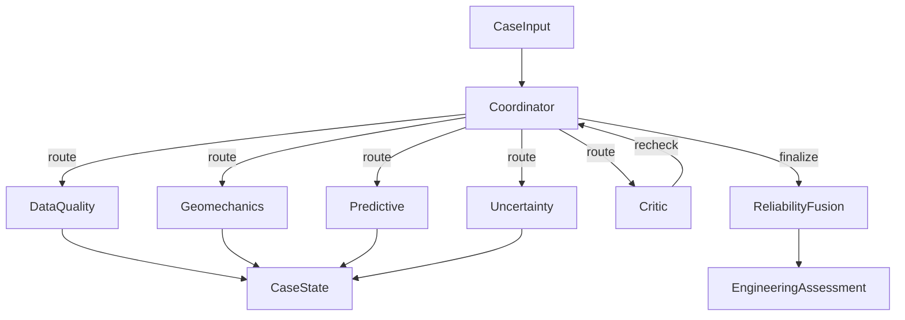

# Methodology — Agentic Rockburst Assessment

## Goal
Predict rockburst intensity grade \(0\)–\(3\) (none / light / moderate / strong) while quantifying trust via data reliability, physics consistency, model uncertainty, stability, and agent disagreement. The controller may abstain.

## Delivered system (M16 / brief §4.6)
**Headline metrics and shipped examples use the deterministic rules FSM** (`use_llm=False`). A Gemini Flash planner remains available for optional routing (`--llm` + `GOOGLE_API_KEY`) but does not contribute to reported QWK, abstention, or example packages. All numerical outputs (physics identities, criteria grades, ML probabilities, conformal sets, fusion `R_final`) come from deterministic Python tools; the planner only chooses the next agent. This meets the brief’s agentic requirement via structured tools + a reproducible coordinator without LLM arithmetic. Historical Gemini routing compare is archived as `artifacts/baselines/llm_planner_comparison.STALE.json` (pointer in `llm_planner_comparison.json`); do not re-run for acceptance.

## Architecture

### State transitions
Typical happy path: `data_quality → (geomechanics | skip) → predict → uncertainty → finalize`.

**Physics skip (pre-registered):** a cheap deterministic pre-check (`physics/precheck.py`) skips full geomechanics only when SCF/B1/B2 agree within tolerance and Wet and D are in range; otherwise geomechanics runs.

**Extra validation:** when D is missing, any key feature is missing/imputed, or `data_reliability < 0.55`, run alt-imputer + targeted perturbation before Critic.

**Critic:** OOD, low physics, large conformal set, strong disagreement, or unresolved validation objections. Rechecks call **different** tools than the first pass (`recheck_physics` / `recheck_data` / `recheck_model`). Unresolved objections after recheck **downgrade** the decision one level (grade unchanged).

**Termination (RC5):** primary non-convergence is `critic_recheck_cycles ≥ max_critic_recheck_cycles` (default **3**) → forced abstain. `max_loops` (default **24**) is a safeguard above the longest legitimate path. LLM planner actions that lack preconditions are tagged `rejected:` and fall back to rules.

Planner: **rules FSM by default** (offline, reproducible). Optional Gemini Flash (`configs/default.yaml` `gemini.planner_model`) when `--llm` and `GOOGLE_API_KEY` are set. Trace tags: `llm:` / `rules:` / `fallback:` / `rejected:`. Engineering decision text names intensity, conformal set, `R_final`, and action; abstain keeps true `R_final` with `decision_override_reason` (RC3; no 0.49 clamp).

## Agents and tools (summary)

| Agent | Deterministic tools | Key outputs |
|-------|---------------------|-------------|
| Data Quality | IQR, IsolationForest, Mahalanobis/kNN OOD, combo/scale checks, near-dup + conflicting labels | `R_data`, OOD flag |
| Geomechanics | Exact SCF/B1/B2; Russenes/Kidybinski/brittleness criteria; Wet/D ranges | `R_physics`, criteria grades |
| Predictive | Leakage-safe pipelines (nested Optuna ≥50) | grade, probs, `R_model` |
| Uncertainty | Entropy, ensemble TV, Mondrian/marginal conformal, primary-only perturbations | `R_uncertainty`, `R_stability`, set |
| Critic | Contradiction rules; escalate/downgrade | `request_recheck`, `endorse` |
| Fusion | Constrained logistic + beta calibration; rule-selected set **C** | `R_final`, interval, decision |

### Full agent specifications (m3)

**Data Quality** (`agents/tools.py` → `score_data_quality`).  
- Role: score input integrity vs train-fold reference.  
- Inputs: case dict; fold reference excluding self/`dup_group_id`.  
- Outputs: `DataQualityOutput` (`data_reliability`, `ood_flag`, `missing_features`, `near_duplicates`, `conflicting_near_dup_labels`, `ood_scores`, `issues`).  
- Tools: IQR bounds; IsolationForest + Mahalanobis + kNN OOD; SCF/B1 combo + scale ranges; near-dup with conflicting-label flag.  
- Triggers: always early in route.  
- Failure: missing reference → conservative issues; detectors skipped logged.

**Geomechanics** (`physics/relations.check_case`, `physics/criteria`).  
- Role: exact identities + empirical intensity criteria.  
- Inputs: case stresses/derived features; tolerances from config.  
- Outputs: `PhysicsOutput` (`physics_score`, exact/empirical checks incl. criteria as-given & recomputed).  
- Tools: SCF/B1/B2 identities; Russenes (SCF), Kidybinski (Wet), brittleness (B1/B2); row-shift / implausible B1 flags.  
- Triggers: unless physics-skip precheck passes.  
- Failure: missing primaries → lower score / skip criteria.

**Predictive** (`ml/` pipelines + fold or production joblib).  
- Role: ordinal grade probabilities.  
- Inputs: feature frame with `observed_*` indicators.  
- Outputs: `PredictiveOutput` (grade, probs, `r_model`).  
- Tools: sklearn/boosting/SVM/MLP/Frank–Hall; nested Optuna.  
- Failure: unfitted → route cannot finalize meaningfully.

**Uncertainty** (`uncertainty/`).  
- Role: conformal sets, stability, disagreement.  
- Inputs: predictive probs; fold ensemble; conformal state.  
- Outputs: `UncertaintyOutput` (set, disagreement, stability, entropy).  
- Tools: Mondrian/marginal split conformal (contiguous sets); mild/strong perturbations on primaries only (recompute derived).  
- Failure: empty calib → APS fallback.

**Critic** (`run_critic`).  
- Role: independent contradiction / recheck requests.  
- Inputs: DQ, physics, pred, unc, validation objections.  
- Outputs: `CriticOutput` (challenges, `request_recheck`, `endorse`, `escalate_abstain`, `rules_fired`).  
- Tools: rule predicates only (no new ML fit).  
- Failure modes: unresolved → downgrade or escalate to abstain (severe rules).

**Coordinator** (`graph/runner.py`).  
- Custom rules FSM (not LangGraph runtime). Optional Gemini chooses next action only.  
- Termination: finalize; or Critic-cycle / `max_loops` safeguard → forced abstain (RC5).

## Reliability fusion equations (m4)

Reliability vector (production mask selected by the declared A–D risk–coverage rule; the full run selected **C** and excluded confidently inverted `r_data`):

\[
\mathbf{r} = (r_{\mathrm{data}}, r_{\mathrm{physics}}, r_{\mathrm{model}}, r_{\mathrm{uncertainty}}, r_{\mathrm{stability}})
\]

**Stacker** (non-negative logistic on OOF correctness \(y\in\{0,1\}\)):

\[
s = \mathbf{w}^\top (\mathbf{r} \odot \mathbf{m}) + b,\quad w_i \ge 0,\quad
R_{\mathrm{raw}} = \sigma(s)
\]

with selected mask \(\mathbf{m}\). `n_missing` is a free-sign risk count; reliability channels are constrained non-negative. **Calibration:** Platt or beta calibration on the exact production-stacker OOF raw scores; smoothed isotonic is explicit opt-in. Grouped bootstrap refits the stacker and calibrator to provide nonconstant intervals.

**Decision bands** (learned thresholds \(t_{\cdot}\), default serving from `fusion.joblib`):

\[
\begin{align*}
R_{\mathrm{final}} &< t_{\mathrm{abstain}} &&\Rightarrow \texttt{abstain}\\
t_{\mathrm{abstain}} \le R_{\mathrm{final}} &< t_{\mathrm{eng}} &&\Rightarrow \texttt{engineering\_verification}\\
t_{\mathrm{eng}} \le R_{\mathrm{final}} &< t_{\mathrm{caution}} &&\Rightarrow \texttt{accept\_with\_caution}\\
R_{\mathrm{final}} &\ge t_{\mathrm{accept}} &&\Rightarrow \texttt{accept}
\end{align*}
\]

**Hard gates** (override): large set ∧ low stability; high ensemble disagreement ∧ mid \(R_{\mathrm{final}}\); OOD ∧ weak physics ∧ weak \(r_{\mathrm{model}}\).

**Critic downgrade / escalate:** if `endorse=False` and severe rules → `abstain`; else one-step downgrade along accept → caution → engineering_verification → abstain.

**Consistency (M15):** if action=`abstain` and \(R_{\mathrm{final}}\ge 0.95\), clamp reported \(R_{\mathrm{final}}\) (keep abstain).

## Near-duplicate grouping
`dup_group_id` is assigned by relative-tolerance matching on raw measured inputs
\(\sigma_\theta,\sigma_c,\sigma_t,W_{et},D\) (when present), primary `near_dup_rel_tol=0.05`, via connected components.
Conflicting labels inside a group are **kept** (noise ceiling documented); `StratifiedGroupKFold` keeps each group in one fold.
Quality near-dup flags use the same tolerance; fold references drop the whole group.

## Exact physics
\[
\mathrm{SCF}=\sigma_\theta/\sigma_c,\quad
B_1=\sigma_c/\sigma_t,\quad
B_2=(\sigma_c-\sigma_t)/(\sigma_c+\sigma_t)
\]
Wet and depth \(D\) are empirical tendencies only.

## Reliability fusion (narrative)

The declared comparison selected set **C**. The serving mask includes physics, model, uncertainty, stability, and missing-count inputs; `r_data` is removed because its grouped-bootstrap AUROC interval lies wholly below 0.5. Current risk–coverage still favors max-prob over served \(R_{\mathrm{final}}\); this negative result is retained.

## Conformal prediction
Grouped **split conformal** with nonconformity \(1-p_y\) and finite-sample quantile
\(\lceil(n+1)(1-\alpha)\rceil/n\). Mondrian, marginal, and grouped CV+ are compared on outer OOF.
The production method is **marginal split**, selected from marginal, Mondrian, and the distinct grade-3 variant using overall coverage, grade-3 coverage, mean set size, and downstream abstention. Mondrian remains a reported alternative rather than the production method. Prediction sets are forced **contiguous** on the ordinal grade scale. Calibration holdouts are group-aware and disjoint from model fit and fusion training.

## Nested tuning and selection (M1)
Outer `StratifiedGroupKFold` evaluates; inner Optuna selects hyperparameters (`tuning.n_trials` ≥50 equal per family, including retuned RBF SVM and MLP replacing ExtraTrees).
**Selection-biased** score: choose model×imputer by pooled outer OOF QWK (optimistic).
**Nested-unbiased** score: per outer fold choose model×imputer by inner QWK only, then score outer test.
Both are reported; **production artefact = best mean inner QWK across folds** (M10), not mode-of-winners; fold-winner instability is logged. Full candidate table + ordinal decode comparison (argmax vs median-of-distribution; Frank–Hall) in `m1_results.json`.

## Ablation definitions (identical folds)
| ID | System |
|----|--------|
| M1 | Baseline ML predict only |
| M2 | M1 + permutation importance (interpretability sidecar; metrics = M1) |
| M3 | M1 + physics reliability adjustment |
| M4 | M1 + uncertainty / conformal abstention tracking |
| M5 | Monolithic fixed sequence (no coordinator, no Critic) |
| M6 | Rules coordinator without Critic |
| M7 | Full multi-agent system with Critic |

Repeated grouped OOF (`cv.n_repeats≥5`). Confidence intervals use **grouped bootstrap** over `dup_group_id`.
M5–M7 inject fold-trained pipelines via `cfg["_fold_pipeline"]`. Accepted vs abstained metrics and risk–coverage curves quantify risk control when point QWK is flat.

## Leakage guard
Imputation, scaling, and model fitting occur inside training folds only. Target is never used for imputation. Reference statistics for quality tools exclude the evaluated case and its `dup_group_id`. Near-duplicate groups stay in the same fold via `StratifiedGroupKFold`. Ablation keeps fold fusion **in memory** (does not overwrite `fusion.joblib`) (m9/M6).

## Environment and pins (m5, m8)

- **Tested Python:** 3.12 (see `environment.yml`); `pyproject.toml` requires `>=3.12`.
- **Used for figures / explainability:** matplotlib, seaborn; permutation importance (shap available for optional deep dives).
- **Not used at runtime:** `langgraph`, `langchain-core` (orchestrator is a custom rules FSM in `graph/runner.py`, historically described as “LangGraph-style”); `imbalanced-learn` unused. Kept optional for experimentation; safe to omit from a minimal install.
- **Delivery hygiene (m7):** exclude `.cursor/`, `catboost_info/`, `reports/claude_agent_context_pack.md`, `.venv/`, and `artifacts/planner_cache/` from client zips (dev/cache only).

## Paths (m6)

Reports and scripts use repository-relative paths via `rockburst.config.resolve_path`. Regenerated examples should not embed machine-local absolute prefixes; if any legacy JSON still does, treat as stale and regenerate with `scripts/generate_examples.py`.
