# Technical Report — Rockburst Agentic AI

**Consolidated Round-3 remediation run.** Headline numbers come from full-mode artefacts (`quick=false`; see `artifacts/baselines/headline_snapshot.json` after figure regeneration). Superseded values remain only in the [history appendix](#history-appendix).

**Delivered system:** deterministic **rules FSM**. Gemini planner optional/archived; not used for reported metrics.

Figures **F1–F17**: `artifacts/figures/` (≥300 dpi PNG + PDF) with `captions.md`.

---

## Lead findings

### (a) Label noise / missing-D (RM13)

Near-duplicate later copies often carry a higher grade. After **dropping rows 315–344**, mean grade with-D vs missing-D converges (~1.54 vs ~1.55) — the Round-2 association largely disappears. Artefact: `triplet_label_sensitivity.json` → `missing_d_comparison`.

### (b) M1 by protocol (`m1_results.json`, full train)

| Protocol | QWK | Accuracy | Note |
|----------|-----|----------|------|
| Nested-unbiased OOF | **~0.703** | **0.625** | Per-fold inner QWK selection |
| Production pooled OOF (`lightgbm__median`) | **~0.697** | — | Production = **best mean inner QWK** |
| Selection-biased | higher | — | Optimistic; do not cite as primary |
| Ablation M1 (full 5×5) | **0.670** [~0.62, ~0.71] | **0.583** | `ablation_results.json` (`quick=false`) |

Protected floors from earlier delivery (not weakened): nested **0.697**, production pooled **0.682**. Full-mode ablation **replaces** the invalid quick **0.632** figure everywhere.

### (c) What agents contribute

| Component | Measured effect (`ablation_results.json`, full) |
|-----------|--------------------------------------------------|
| Grades M5/M6/M7 | **Identical QWK** to M1 (agents do not change argmax) |
| Abstention | M3 **0.101**; M4 **0.529**; M5/M6 **0.170**; M7 **0.326** |
| Critic fire rate | **0.922**; decision changed on **0.632** of repeated OOF cases |
| Fusion | Declared rule selected **C**; inverted `r_data` excluded. RC area: max-prob **0.653** vs served R_final **0.642** (Δ≈−0.012) |
| Conformal | Production **marginal_split**; coverage **0.919**, mean set size **2.356** |

### (d) Honest statements (RC4)

- Agents change routes, checks, caution/abstention — **not** grade QWK vs M1.
- On risk–coverage, **served R_final does not beat M1 max-prob**; this negative result is retained.
- Same-coverage comparisons use each system's native accepted subset and the equally sized highest-confidence M1 subset on the same 1,720 predictions. M7 accepts 1,160 (67.4%): accuracy **0.638** versus M1 **0.670**, Δ **−0.032**, 95% CI **[−0.054, −0.010]**.

---

## Dataset

- Table S1, **n = 344**; grades 0–3 (none/light/moderate/strong).
- Features: σθ, σc, σt, SCF, B1, B2, Wet, D; D missing in 131 rows.
- Near-dup grouping at **5%** relative tol on raw measured inputs.

## Training / uncertainty

- Seed 42; nested `StratifiedGroupKFold`; Optuna **n_trials=50**; MLP; Frank–Hall ordinal variants.
- Production conformal: marginal split selected by coverage, grade-3 coverage, set size, and downstream abstention; contiguous sets; alternatives in F12.
- Fusion: non-negative logistic on OOF reliability vector; calibrator on ~344 cross-fitted OOF (RC3); learned decision bands (methodology). No 0.49 confidence clamp.

## Ablation (full 5×5; see F9)

| Model | QWK (mean) | Abstention | Severe-error |
|-------|------------|------------|--------------|
| M1–M2 | 0.670 | 0 | 0.062 |
| M3 | 0.670 | 0.101 | 0.062 |
| M4 | 0.670 | 0.529 | 0.062 |
| M5–M6 | 0.670 | 0.170 | 0.062 |
| M7 | 0.670 | **0.326** | 0.062 |

M3 abstention is non-zero (perturbation / stability path) — ablation table fixed vs earlier “M3 abs=0” drafts.

### Matched coverage (RC4)

| System | Coverage (n) | Accuracy Δ vs M1 | 95% CI | Severe-rate Δ vs M1 |
|--------|--------------|-------------------|--------|----------------------|
| M3 | 0.899 (1547) | −0.006 | [−0.024, 0.009] | −0.006 |
| M4 | 0.471 (810) | −0.038 | [−0.070, −0.013] | +0.004 |
| M5 | 0.830 (1427) | −0.011 | [−0.024, 0.001] | +0.001 |
| M6 | 0.830 (1427) | −0.011 | [−0.023, 0.002] | +0.001 |
| M7 | 0.674 (1160) | **−0.032** | **[−0.054, −0.010]** | +0.012 |

### Robustness (RC6; n_cases=1720)

| ε | Flip | Mean \|Δp\| | Entropy Δ | Set size | R_final Δ |
|---|------|------------|-----------|----------|-----------|
| mild | 0.140 | 0.061 | 0.015 | 2.476 | −0.004 (CI crosses 0) |
| strong | 0.249 | 0.109 | 0.036 | 2.528 | −0.013 [−0.019, −0.008] |

R_final is **not** flagged flat under strong perturbation (`r_final_flat_under_strong_perturbation=false`).

### Missing-data (RC6)

Imputers tested: **median, knn, iterative**. Every scenario reports 25 folds, mean cases/fold, total evaluations, abstention, accepted accuracy, confidence change, accuracy change, and CIs. On the M7 path, masking D yields abstention **0.355**, accepted accuracy **0.655**, ΔR_final **−0.007**, and accuracy change **−0.053**. Reconstructing σθ from SCF·σc has near-zero confidence/accuracy change; removing SCF too causes significant degradation.

### Critic rule detection (RM2)

Per-rule flagged-vs-unflagged error and AUROC: `critic_statistics.rule_detection_rates` (F16). Highest AUROCs in this run: `validation_objection` ≈0.610, `large_prediction_set` ≈0.595, `ml_vs_criteria` ≈0.568. Severity from stats: `rule_severity_from_stats`.

### Criterion–label agreement (RM5)

`criterion_label_agreement` on n=344: Russenes 0.419, Kidybinski 0.494, B1 0.189, Hoek 0.334, and consensus 0.384. Because consensus precision is below 0.40, the statistics-driven severe agreement cut is disabled (`1.01`) rather than presenting a worse-than-chance rule as severe.

### Triplet / label policies (RM12 / RM13)

See `triplet_label_sensitivity.json`: production M1+M7 under (σc, σt, Wet) groups; policies `as_given`, `drop_rows_315_344`, `earliest_of_conflict`.

## Brief §10 constraints

| Constraint | Status | Evidence |
|------------|--------|----------|
| No prompt-only agents | **met** | Deterministic tools only for numbers |
| Do not claim more agents ⇒ better grades | **met** | M5≡M6≡M7 on QWK |
| No test leakage in fit/selection | **met** | Nested CV; OOF fusion; fold-local refs |
| Fusion justified | **met (negative OK)** | Rule-selected set C; inverted channel removed; R_final ≰ max-prob stated |
| Abstain when inadequate | **met** | Gates + Critic; held-out abstain ≠ failure |
| Not accuracy alone | **met** | QWK, severe, coverage, ECE, RC, Critic rates |
| Full-mode numbers only | **met** | `quick=false`; snapshot refuses quick |

## Figures (RC9)

Every figure is generated from the consolidated artefacts by `scripts/generate_figures.py`; PNG and PDF versions are delivered in `artifacts/figures/`.

### F1 — System architecture

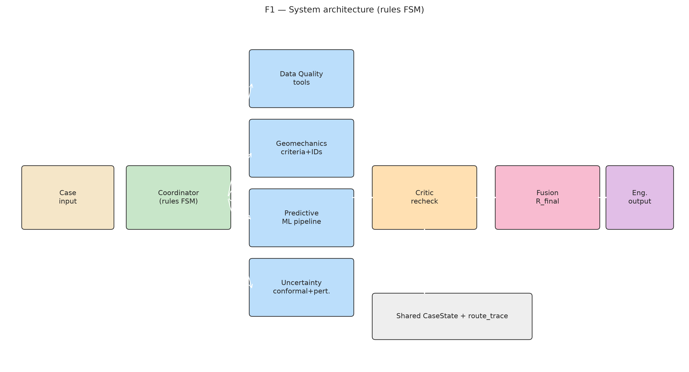

Visible arrows show Case→Coordinator→agent tools→Critic→Fusion→engineering output and shared `CaseState`. The rules FSM is used for headline results; the LLM planner is optional.

### F2 — State transitions

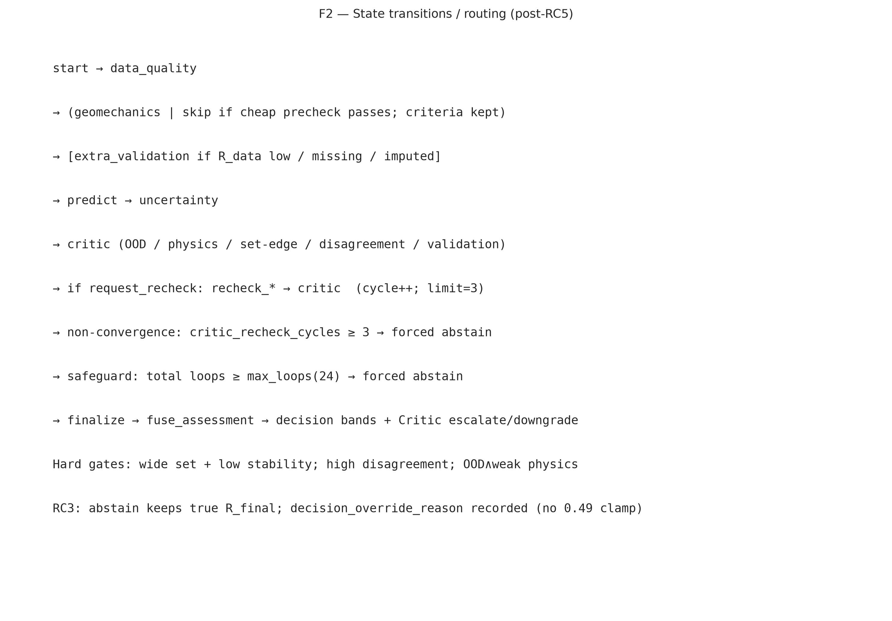

Post-remediation routing includes Critic→recheck cycles (limit 3), the `max_loops=24` safeguard, and all termination and abstention paths.

### F3 — Routing traces

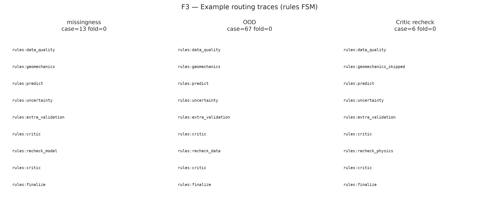

Fresh missingness, OOD, and executed Critic-recheck traces for cases 13, 67, and 6.

### F4 — Dataset overview

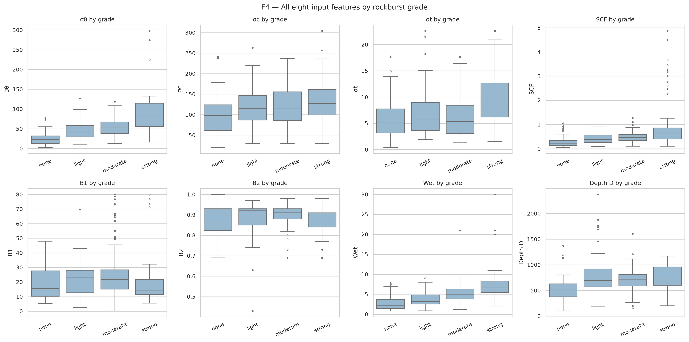

Grade counts, missing-D distribution, rows 315–344, and bounded SCF densities for n=344.

### F5 — Physics consistency

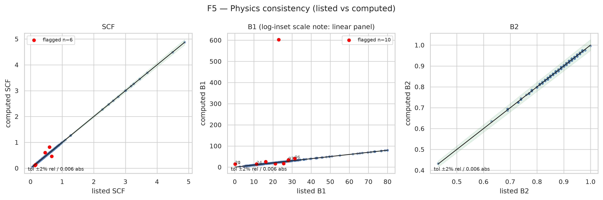

Listed versus recomputed SCF/B1/B2 using 2% relative and 0.006 absolute tolerances; B1 mismatches are identified by case number.

### F6 — Near-duplicate conflicts

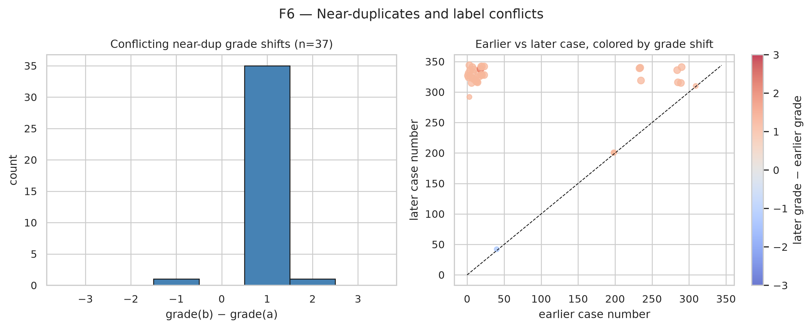

Conflicting pairs at production relative tolerance 0.05, including the later-copy grade-shift pattern.

### F7 — Confusion matrices

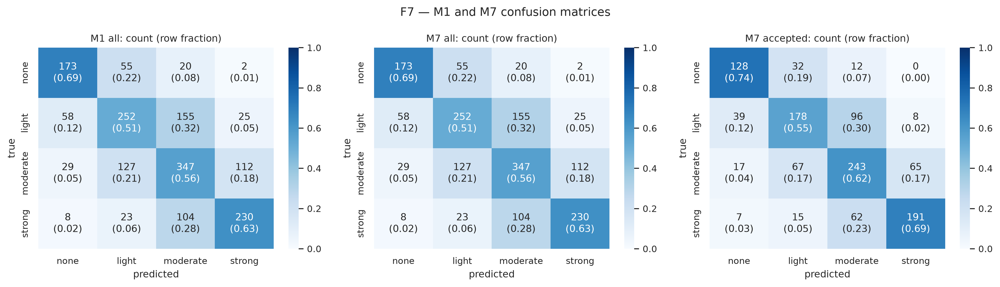

Real nested-unbiased M1 confusion counts and row-normalized values (n=344, five folds). M7 preserves grade predictions and changes the accepted subset.

### F8 — Model comparison

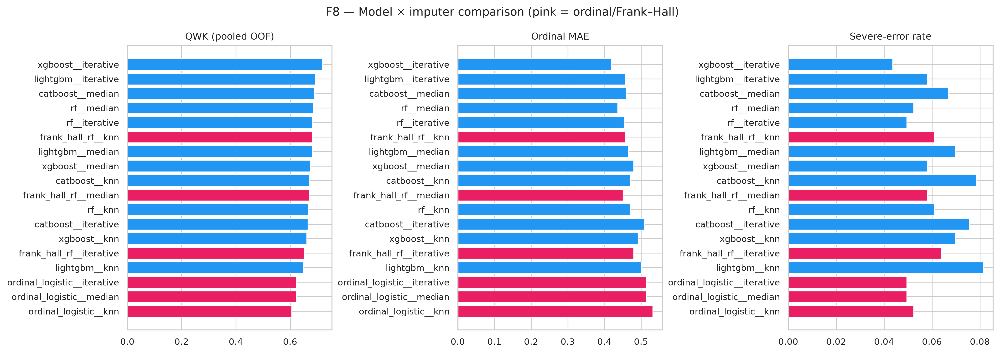

Candidate fold-QWK confidence intervals, multiclass/ordinal comparison, and production `lightgbm__median` selection over five outer folds.

### F9 — M1–M7 ablation

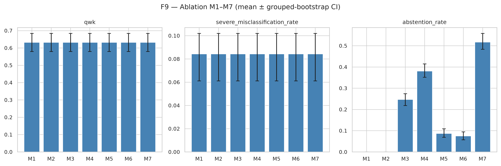

QWK, severe-error rate, and abstention with grouped-bootstrap intervals over n=344, five folds, and five repeats.

### F9b — Risk–coverage areas

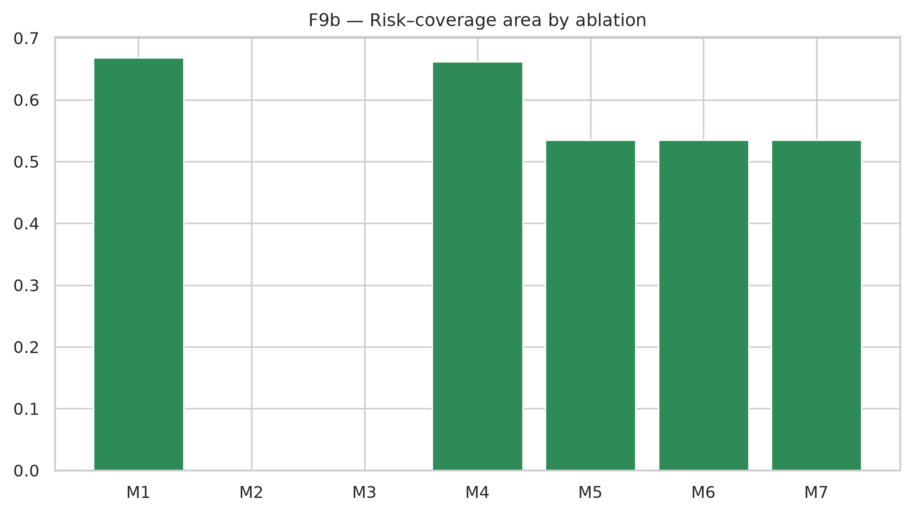

Pooled areas and per-system same-coverage deltas against M1 on 1,720 repeated OOF predictions.

### F10 — Risk–coverage curves

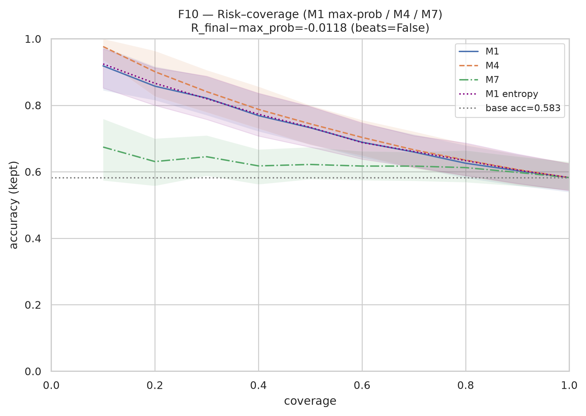

Pooled common-axis curves for M1, M4, and M7 with base accuracy. Served R_final does not beat M1 max-prob.

### F11 — Reliability

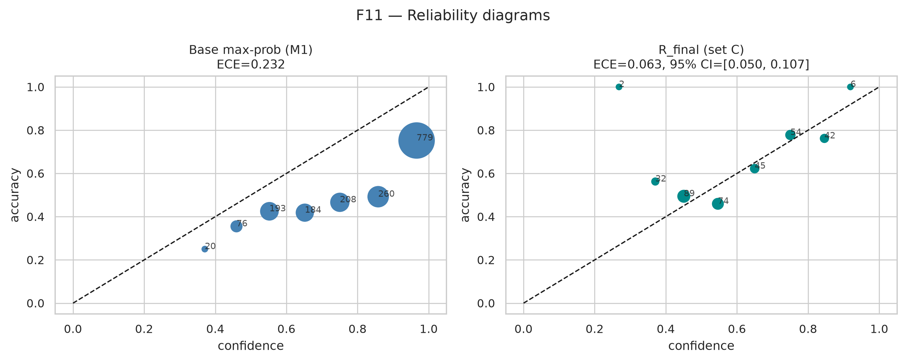

Real M1 max-probability and served fusion-set-C reliability bins with counts and ECE evidence (n=344).

### F12 — Conformal prediction

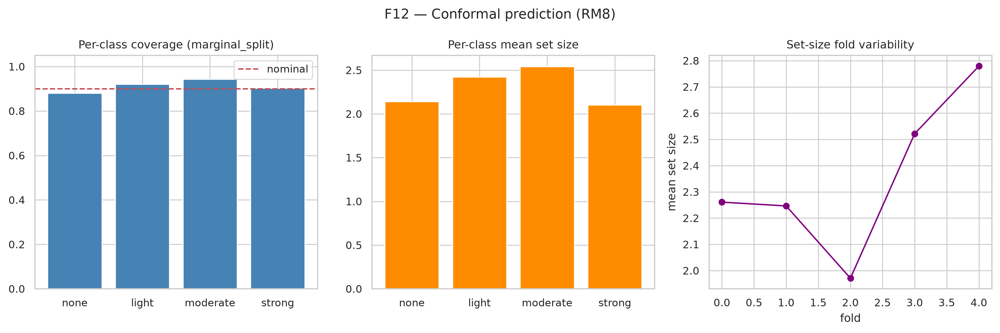

Per-class coverage, mean set size, fold variability, and method comparison; production method is `marginal_split` at α=0.1.

### F13 — Robustness

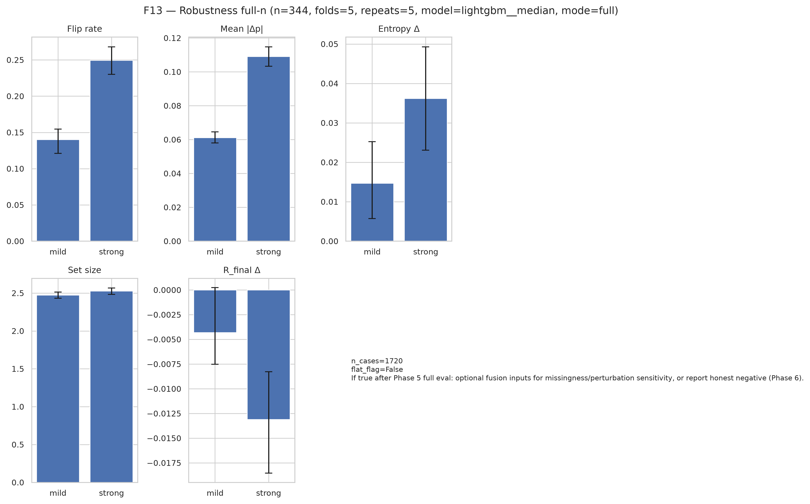

Full 1,720-assessment mild/strong perturbation results for prediction flips, probability change, entropy, set size, and R_final.

### F14 — Missing data

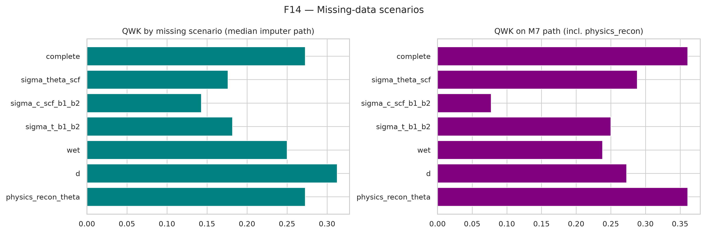

Median, kNN, and iterative imputers; physical reconstruction; confidence, accuracy, abstention, and train/inference protocol evidence.

### F15 — Explainability

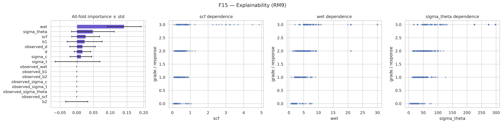

All-fold permutation importance, SCF/Wet/σθ model dependence, and local-explanation evidence.

### F16 — Critic performance

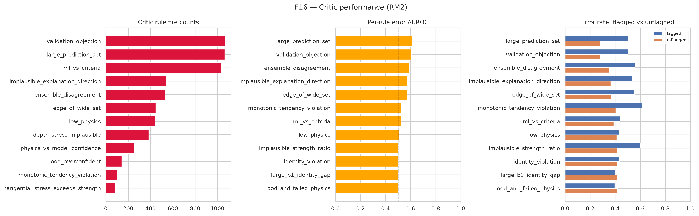

Per-rule firing, AUROC, and flagged-versus-unflagged error evidence over the consolidated evaluation.

### F17 — Fusion

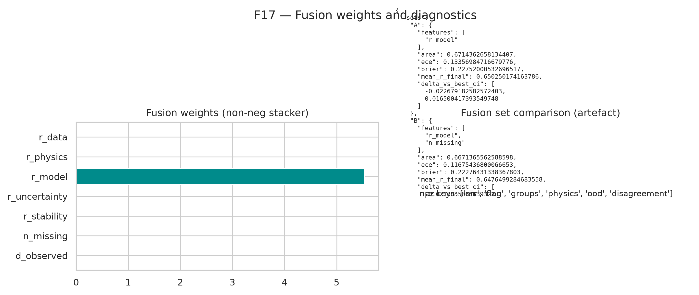

Production set-C weights with bootstrap intervals, component AUROC, and served-confidence evidence.

## Examples (RC7 / RC8)

- Held-out **abstain**: `case_no=129` — `abstain_case.json` / `heldout_abstain_case_129.json`.
- Held-out **accepted-wrong** failure: `case_no=88` — `failure_case.json` / `heldout_failure_case_88.json` + `failure_analysis.md`. Distinct from abstain (`c5_selection_summary.cases_distinct=true`). Absolute error = **2** (light predicted versus strong observed).
- Corrupt OOD: `case_corrupt_ood.json` with recorded `perturbation` (bytes ≠ `case_146.json`).
- Forced abstain: production Critic-cycle limit (`forced_abstain_case.json`: `termination_reason=forced_abstain_critic_cycles`, `max_critic_recheck_cycles=3`, `max_loops=24`).

## Limitations

- Small n; duplicate-label authority unresolved.
- The declared selection rule chose multi-channel fusion set C, but served R_final still underperforms max-prob on risk–coverage; this negative result limits claims about fusion benefit.
- Critic per-rule AUROCs are modest (≈0.50–0.61); detection rates in artefact — do not over-claim rule discriminative power.
- The executed notebook is a demonstration, not a substitute for the full command-line 5×5 evaluation.

## Artefacts

| Path | Content |
|------|---------|
| `artifacts/baselines/m1_results.json` | Nested/biased M1, conformal, decode, run_metadata |
| `artifacts/baselines/ablation_results.json` | Full M1–M7, matched_coverage, robustness, missing |
| `artifacts/baselines/triplet_label_sensitivity.json` | RM12/RM13 |
| `artifacts/baselines/fusion_set_comparison_slice4.json` | Set A–D, AUROC, bootstrap CIs |
| `artifacts/baselines/headline_snapshot.json` | Report number snapshot (full only) |
| `artifacts/archive/` | RC8 archived non-final baselines/traces |
| `artifacts/figures/` | F1–F17 |
| `artifacts/examples/` | Held-out + failure analysis |

---

## History appendix

Superseded numbers (do **not** cite as current):

| Topic | Old values | Superseded by |
|-------|------------|---------------|
| Ablation M1/M7 QWK | **0.632** (quick) | Full-mode **0.670** |
| M7 abstention | 0.517 / 0.780 (superseded routing runs) | Current full-mode **0.326** |
| Production model | `rf__iterative` (prior mean-inner) | Current `lightgbm__median` (same rule) |
| RC R_final vs max-prob | 0.535 vs 0.668 | Full-mode **0.642 vs 0.653** |
| Nested M1 QWK | 0.697 floor | Current nested **~0.703** |
